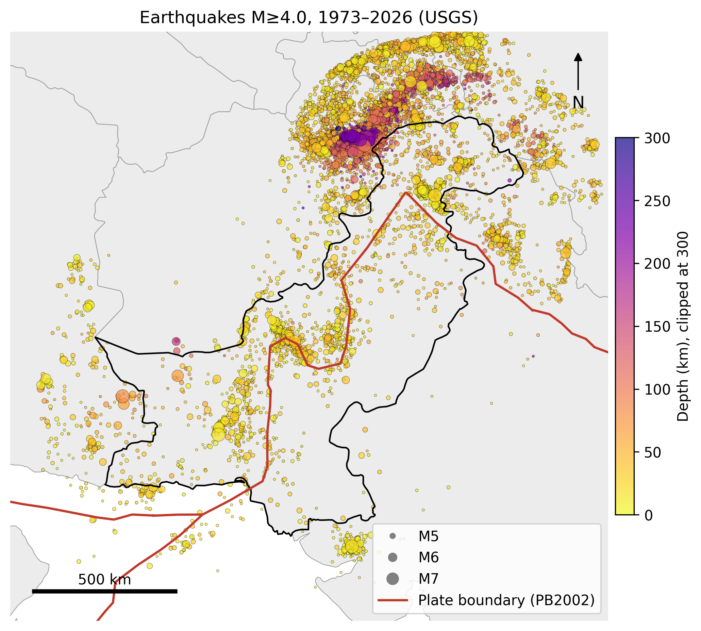
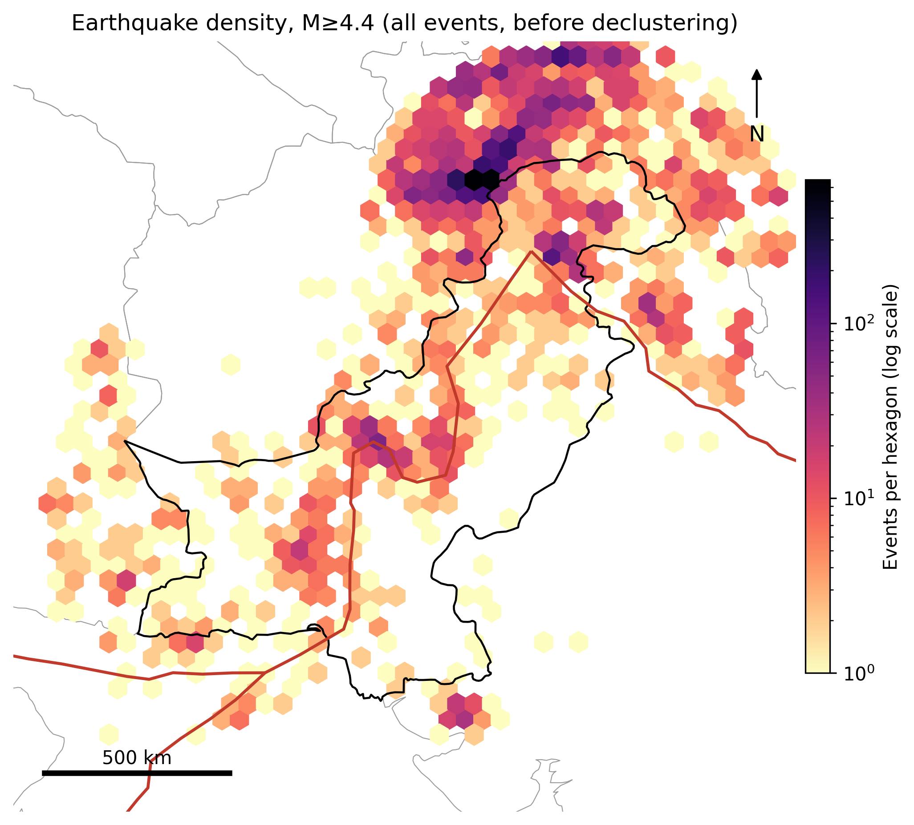
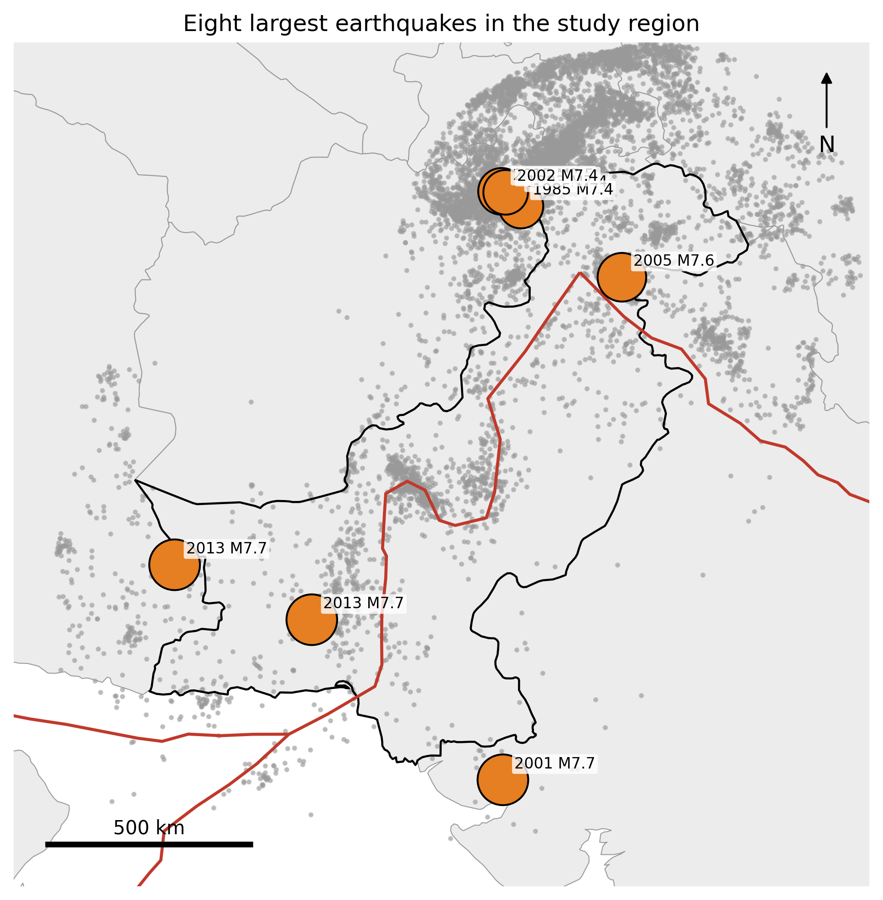
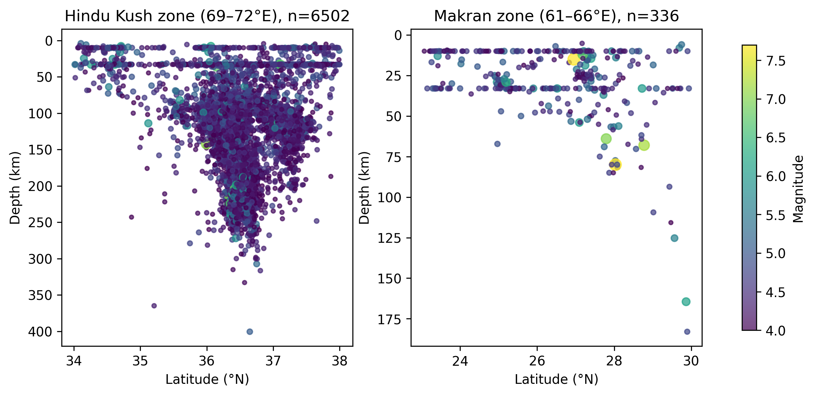
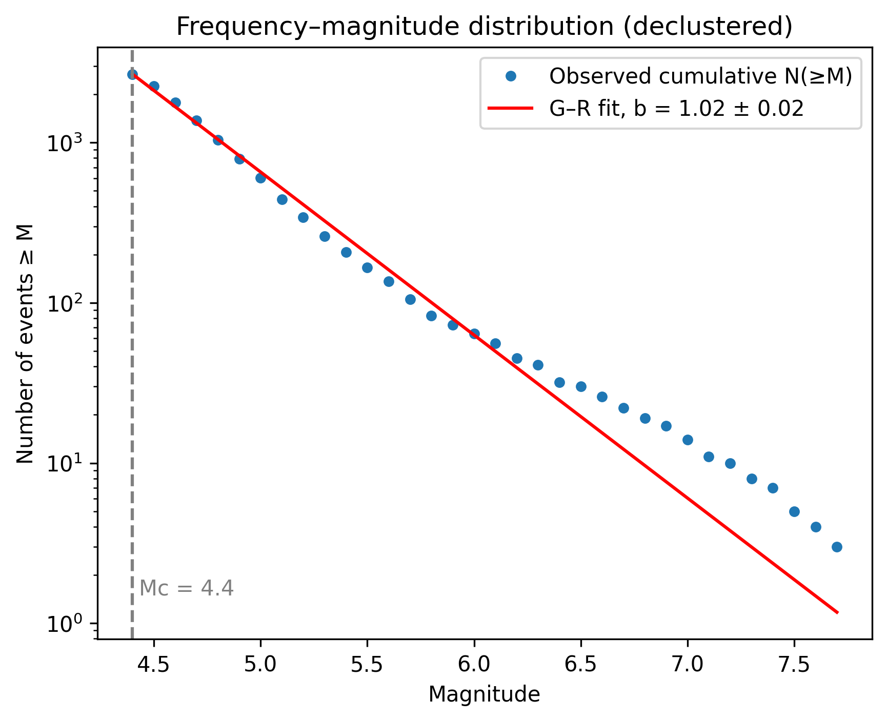
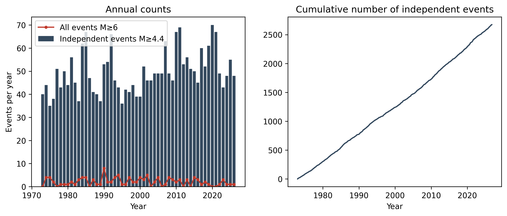
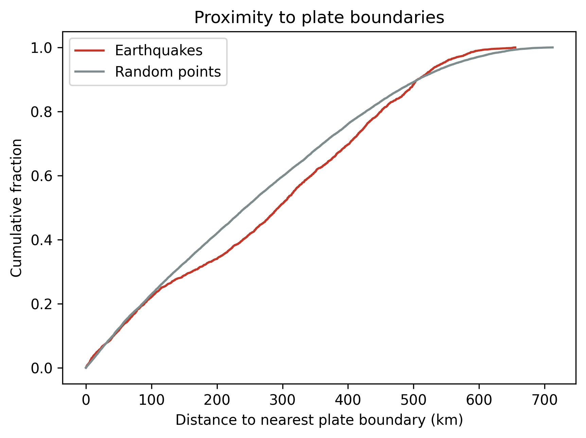

# Seismotectonic Analysis of Pakistan

I analysed 50 years of earthquakes in and around Pakistan (1973–2026) to see where they happen, how deep they are, how often large ones occur, and how they relate to plate boundaries. All work is in Python and runs on Google Colab.

**Notebook:** `Pakistan_Seismotectonic_Analysis.ipynb`

## Data
- Earthquakes (M ≥ 4.0): USGS earthquake catalog (ComCat), 14,662 events downloaded for the wider region, 13,418 inside the study region
- Plate boundaries: PB2002 model (Bird, 2003)
- Country borders: Natural Earth
- Study region: Pakistan plus a 300 km buffer

## Methods
1. Completeness magnitude (Mc = 4.4) found by the maximum curvature method with a 0.2 correction (7,493 events at M ≥ 4.4).
2. Aftershocks removed with Gardner and Knopoff (1974) windows, leaving 2,673 independent events at M ≥ 4.4.
3. Gutenberg–Richter b-value by maximum likelihood, with a bootstrap confidence interval.
4. Distances and densities calculated in an equal-area map projection.
5. Monte Carlo comparison with 20,000 random points inside the study region: how close are independent earthquakes to the nearest plate boundary, for all events and for shallow events (40 km or less)? Medians were compared by resampling, and the share of events within 50, 100 and 200 km of a boundary was compared with the share of random points.

## Main results
- **b-value = 1.02 ± 0.02** (95% interval 0.98 to 1.05), a typical value.
- Earthquakes are concentrated in the north (Hindu Kush, Pamir, Himalayan front) and the southwest (Balochistan, Makran).
- Very deep earthquakes (down to about 300 km) occur only in the Hindu Kush zone.
- The largest events include Kashmir 2005 (M7.6), Balochistan 2013 (M7.7) and Hindu Kush 2015 (M7.5).

**Relationship to plate boundaries (mixed result):**
- **All independent events (2,673):** not closer to a plate boundary than random points. The median distance is 294 km versus 243 km for random points (Monte Carlo p = 1.0), and 34.0% of events lie within 200 km of a boundary versus 42.0% of random points. Within 50 km the shares are 11.6% versus 12.3%, and within 100 km 22.1% versus 22.9%.
- **Shallow events only (40 km or less, 1,691 events):** enriched close to the boundary. 16.7% lie within 50 km versus 12.3% of random points (ratio 1.37), and 30.6% within 100 km versus 22.9% (ratio 1.33). The difference is small by 200 km (44.4% versus 42.0%, ratio 1.06).
- Even for shallow events the median distance is not smaller than for random points (259 km versus 243 km), so the enrichment is limited to the first 50 to 100 km.
- Reading: shallow earthquakes cluster near some boundary segments, but earthquakes overall are not concentrated along the PB2002 boundaries in this region. Much activity lies in the broad deformation zones of the Hindu Kush, Himalaya and Balochistan, which the coarse PB2002 lines do not capture well.

## Maps and figures

## Limits
- The USGS catalog mixes magnitude types, and magnitudes can differ by 0.1 to 0.3 between agencies.
- Many events have default depths (about 10 km and 33 km) when depth is poorly known.
- PB2002 is a coarse global model and does not include every active fault, so distances to it are only a rough proxy for distance to real faults.
- Earthquakes cluster in space, so p-values from the boundary comparisons are only a guide. The shares and ratios are the main result.
- This shows association, not cause.
- Volcano data is not included in this version.

## How to run
Open the notebook in Google Colab and choose Runtime, then Run all. An internet connection is needed. When the optional volcano cell asks for a file, click Cancel upload.

## Data sources
- USGS Earthquake Catalog: https://earthquake.usgs.gov
- Bird, P. (2003). An updated digital model of plate boundaries. Geochemistry, Geophysics, Geosystems, 4(3).
- Gardner, J. K. and Knopoff, L. (1974). Is the sequence of earthquakes in Southern California, with aftershocks removed, Poissonian? Bulletin of the Seismological Society of America, 64(5).
- Natural Earth: https://www.naturalearthdata.com

Author: Malaika Noor
